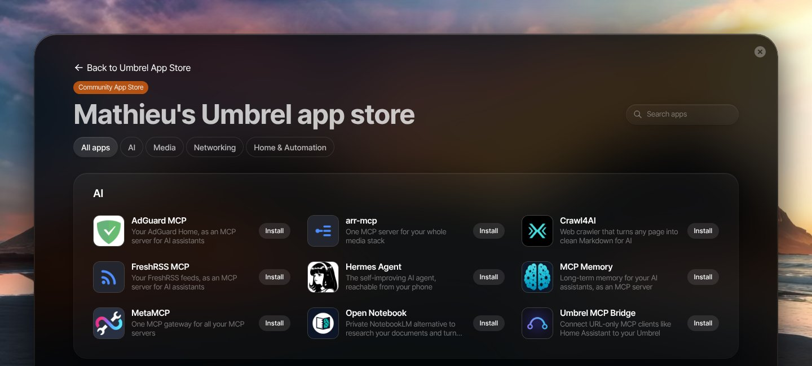

<div align="center">

# Mathieu's Umbrel App Store

**Self-hosted apps for umbrelOS that round out a *arr / Plex / Jellyfin setup.**
Companions for Radarr and Sonarr, torrents behind a VPN, watch trackers, live TV, and MCP servers to drive it all from an AI assistant.

[](https://github.com/mathieuletyrant/umbrel-community-app-store/actions/workflows/validate.yml)




</div>

## ✨ Apps

**🎬 Around Radarr and Sonarr**

- 🪢 [**arrglue**](mathieu-arrglue): finds every *arr app on the Umbrel, checks their links, paths and hardlinks, then creates or repairs the links (plan / apply) · *made here*
- 🎚️ [**Profilarr**](mathieu-profilarr): quality profiles and custom formats from curated TRaSH-style databases, synced to every *arr
- 🧽 [**Cleanuparr**](mathieu-cleanuparr): removes stalled, failed and orphaned downloads from the queues, then searches again
- 🔎 [**NeutArr**](mathieu-neutarr): searches for missing and below-cutoff items a few at a time (the maintained Huntarr fork)
- 🩺 [**Healarr**](mathieu-healarr): finds corrupt files, deletes them, re-downloads through Sonarr / Radarr and checks the replacement
- 📦 [**Unpackerr**](mathieu-unpackerr): extracts `.rar` / `.7z` / `.zip` downloads so Radarr, Sonarr and Lidarr can import them
- 🍿 [**Boxarr**](mathieu-boxarr): the weekly box office top 10, synced with Radarr
- 📋 [**Pulsarr**](mathieu-pulsarr): Plex watchlists → Sonarr / Radarr in real time, for you and your friends
- 🎞️ [**Trailarr**](mathieu-trailarr): trailers next to your movies and shows, played by Plex / Jellyfin / Emby
- 🛡️ [**Byparr**](mathieu-byparr): Cloudflare-bypass proxy for Prowlarr / Jackett, a drop-in FlareSolverr replacement
- 📊 [**Sortarr**](mathieu-sortarr): Prowlarr indexer priorities from your real ratio, buffer and freeleech on each private tracker

**🧹 Library cleanup**

- 🗂️ [**Maintainerr**](mathieu-maintainerr): rule-based cleanup for Plex, with a "Leaving Soon" collection
- ♻️ [**Reclaimerr**](mathieu-reclaimerr): rule-based cleanup for Jellyfin, Plex and Emby, with protect / delete requests
- 🗑️ [**Shredarr**](mathieu-shredarr): delete it in Jellyfin or Plex, it's gone from Sonarr / Radarr / Seerr and the torrent client once seeded

**📚 More libraries**

- 🧩 [**Scryer**](mathieu-scryer): a whole *arr stack (movies, series, anime) in one binary
- ⚽ [**Sportarr**](mathieu-sportarr): a PVR for sports leagues and events
- 🦸 [**Kapowarr**](mathieu-kapowarr): comic book library manager
- 📖 [**Chaptarr**](mathieu-chaptarr): ebooks and audiobooks, the Readarr successor
- 📰 [**Weaver**](mathieu-weaver): Usenet downloader with PAR2 repair and extraction built in

**⬇️ Downloads and VPN**

- 🔒 [**qBittorrent VPN**](mathieu-qbittorrent-vpn): qBittorrent behind Gluetun (any provider), kill switch and forwarded peer port; replaces Transmission for the *arr apps
- 🔒 [**Transmission VPN**](mathieu-transmission-vpn): the same for Transmission
- 🌐 [**Gluetun**](mathieu-gluetun): your VPN as a password-protected HTTP proxy, for the apps you choose
- 🌱 [**cross-seed**](mathieu-cross-seed): seeds what you already have on your other trackers, no extra disk space
- 🔁 [**D3X**](mathieu-d3x): V3X tracker's companion: cross-seed, publish, hit-and-run tracking
- 🎵 [**slskd**](mathieu-slskd): Soulseek client with a web UI
- 🎶 [**Soularr**](mathieu-soularr): Lidarr's wanted list → slskd → Lidarr

**🗣️ Subtitles and files**

- 🌍 [**Lingarr**](mathieu-lingarr): translates subtitles (LibreTranslate, DeepL, OpenAI…)
- 💬 [**Sublarr**](mathieu-sublarr): subtitle manager and LLM translator, a Bazarr + Lingarr alternative
- ✂️ [**Muxarr**](mathieu-muxarr): strips unwanted audio and subtitle tracks without re-encoding
- ⚙️ [**Tdarr**](mathieu-tdarr): automated transcoding and library health checks

**🖼️ Plex and Jellyfin**

- 🏠 [**Agregarr**](mathieu-agregarr): Plex Home collections from Trakt, IMDb, Letterboxd, Top 10s…
- 🎨 [**Posterizarr**](mathieu-posterizarr): consistent posters and title cards for Plex
- 🏷️ [**Labelarr**](mathieu-labelarr): TMDb keywords → Plex labels
- 📈 [**Tracearr**](mathieu-tracearr): monitoring for Plex, Jellyfin and Emby, with account-sharing detection
- 💡 [**lueur**](mathieu-lueur): Ambilight for Jellyfin with Philips Hue, no Sync Box · *made here*
- 🤔 [**SuggestArr**](mathieu-suggestarr): recommendations from your watch history, requested through Seerr
- 🔗 [**Spotarr**](mathieu-spotarr): share a reel from your iPhone, get the movie or show through Seerr · *made here*
- 🔔 [**Notifiarr**](mathieu-notifiarr): Discord notifications and TRaSH sync for the whole stack

**📺 Live TV**

- 📡 [**Dispatcharr**](mathieu-dispatcharr): IPTV playlists and guides, served as an HDHomeRun tuner
- 📺 [**Tunarr**](mathieu-tunarr): live channels built from your own library

**🛋️ Watch tracking**

- 🛋️ [**Snug**](mathieu-snug): a cozy tracker for the TV series you're watching · *made here*
- 🎮 [**Ryot**](mathieu-ryot): movies, shows, books, games and workouts in one tracker
- 🎬 [**Scrob**](mathieu-scrob): your own Trakt, synced with Jellyfin / Plex / Emby
- 🍿 [**Sofa**](mathieu-sofa): your own Trakt / Letterboxd, with phone apps
- 👀 [**Seek**](mathieu-seek): phone-first tracker for shows, films and books

**🤖 AI and MCP**

- 🧠 [**arr-mcp**](mathieu-arr-mcp): one MCP server for Radarr, Sonarr, Prowlarr, Jellyfin, Plex, Seerr…
- 🕸️ [**MetaMCP**](mathieu-metamcp): one gateway for all your MCP servers
- 🗃️ [**MCP Memory**](mathieu-mcp-memory): long-term memory for AI assistants
- 📰 [**FreshRSS MCP**](mathieu-freshrss-mcp): your FreshRSS feeds as an MCP server
- 🛡️ [**AdGuard MCP**](mathieu-adguard-mcp): your AdGuard Home as an MCP server
- 🌉 [**Umbrel MCP Bridge**](mathieu-umbrel-mcp-bridge): connects URL-only MCP clients (Home Assistant) to umbrelOS's MCP server
- 🕷️ [**Crawl4AI**](mathieu-crawl4ai): any web page as clean Markdown, screenshot or PDF, with an MCP server
- 📓 [**Open Notebook**](mathieu-open-notebook): your own NotebookLM, with the AI of your choice
- 🪽 [**Hermes Agent**](mathieu-hermes): Nous Research's self-improving agent, reachable from your phone

**🧰 Other**

- 💓 [**Vitals**](mathieu-vitals): your media stack's health as one JSON API, for your own dashboard · *made here*
- 🛰️ [**Traccar**](mathieu-traccar): GPS tracking for phones, cars and trackers, with Home Assistant support

## 🚀 Install

1. In umbrelOS, open the **App Store**, then **⋯** (top right) → **Community App Stores**.
2. Add this repository's URL:

   ```
   https://github.com/mathieuletyrant/umbrel-community-app-store
   ```

3. Open **Mathieu's Umbrel App Store** and install any app. Each listing says how to set it up.

> [!NOTE]
> Community app stores are third-party: only add stores you trust, their apps run on your own hardware.

## 🔗 Connecting apps

The apps of this store don't wire themselves to your other apps: you connect them in each app's
settings. Apps on your Umbrel reach each other by these addresses (copy them from here):

| App | Address | API key |
|---|---|---|
| Radarr | `http://radarr_server_1:7878` | Settings → General |
| Sonarr | `http://sonarr_server_1:8989` | Settings → General |
| Lidarr | `http://lidarr_server_1:8686` | Settings → General |
| Readarr | `http://readarr_server_1:8787` | Settings → General |
| Prowlarr | `http://prowlarr_server_1:9696` | Settings → General |
| Bazarr | `http://bazarr_server_1:6767` | Settings → General → Security |
| Jellyseerr | `http://jellyseerr_server_1:5055` | Settings → General |
| Overseerr | `http://overseerr_server_1:5055` | Settings → General |
| SABnzbd | `http://sabnzbd_web_1:8080` | Config → General |
| Tautulli | `http://tautulli_web_1:8181` | Settings → Web Interface |
| Transmission | `http://transmission_server_1:9091` (RPC: `/transmission/rpc`) | none |
| Transmission VPN | `http://mathieu-transmission-vpn_gluetun_1:9091` (RPC: `/transmission/rpc`) | none |
| qBittorrent VPN | `http://mathieu-qbittorrent-vpn_gluetun_1:8080` | `admin` and the app's default password (umbrelOS) |
| Gluetun (HTTP proxy) | host `mathieu-gluetun_gluetun_1`, port `8888`, username `proxy` | its default password |
| Plex | `http://host.docker.internal:32400` | your Plex token |
| Jellyfin | `http://jellyfin_server_1:8096` | Dashboard → API Keys |
| Crawl4AI | `http://mathieu-crawl4ai_server_1:11235/mcp/sse` (MCP) | its default password (bearer token) |
| Hermes Agent | `http://mathieu-hermes_server_1:8642/v1` (OpenAI-compatible API) | its default password |
| Traccar | `http://mathieu-traccar_server_1:8082` | a Traccar account (email and password) |
| SearXNG | `http://searxng-web:8080` | none |
| Ollama | `http://ollama_ollama_1:11434` | none |
| Healarr | `http://mathieu-healarr_server_1:3090` | its settings |
| Cleanuparr | `http://mathieu-cleanuparr_server_1:11011` | its account settings |
| Maintainerr | `http://mathieu-maintainerr_server_1:6246` | none |
| Tracearr | `http://mathieu-tracearr_server_1:3000` | its settings |
| slskd | `http://mathieu-slskd_server_1:5030` | its options (`web.authentication.api_keys`) |
| Byparr | `http://mathieu-byparr_server_1:8191` | none |
| Shredarr | `http://mathieu-shredarr_server_1:8089` (Jellyfin webhook) | none |
| Scrob | `http://mathieu-scrob_server_1:7330` | in the webhook URLs of its Connections |
| Sofa | `http://mathieu-sofa_server_1:3000` | in the URLs of its Settings → Integrations |
| Seek | `http://mathieu-seek_server_1:8100` (Jellyfin webhook) | in your personal Jellyfin webhook URL |
| Snug | `http://mathieu-snug_server_1:3000` (Jellyfin webhook) | in the webhook URL of its Settings → Jellyfin |
| Vitals | `http://mathieu-vitals_server_1:3000/v1/summary` | its default password (bearer token) |
| MetaMCP | `http://mathieu-metamcp_server_1:12008/metamcp/<endpoint>/mcp` (MCP) | an API key from its API Keys page |
| arr-mcp | `http://mathieu-arr-mcp_server_1:6060/mcp` (MCP) | the bearer token on its dashboard |
| MCP Memory | `http://mathieu-mcp-memory_web_1/mcp` (MCP) | its default password (bearer token) |
| AdGuard MCP | `http://mathieu-adguard-mcp_web_1/mcp` (MCP) | its default password (bearer token) |
| FreshRSS MCP | `http://mathieu-freshrss-mcp_web_1/mcp` (MCP) | its default password (bearer token) |
| Spotarr | `http://mathieu-spotarr_server_1:3000/mcp?token=<MCP token>` (MCP) | Settings → Access |
| umbrelOS | `http://host.docker.internal/mcp` (MCP, apps declaring `host.docker.internal`) | a `umbrelmcp_` token from Settings → MCP |

Plex runs on the host network: apps reach it through `host.docker.internal` (the store's apps that
need it declare it), and Plex reaches an app through `http://127.0.0.1:<the app's port>`.

## 🔄 Updates

[Renovate](https://github.com/renovatebot/renovate) opens a pull request for every new upstream image (a rebuild of the same version only on the 1st of the month). For each one, an AI agent ([Claude Code](https://claude.com/claude-code)) reads the upstream changelog, writes the release notes, installs the app on a test umbrelOS and posts a screenshot of it running. Verified patch and minor updates are merged; the rest wait for me. Updates then show up in umbrelOS like any other app update.

> [!IMPORTANT]
> Apps are tested on a real umbrelOS before release, not by a human on every hardware setup, and the agent can get things wrong. Upstream developers don't maintain these packages: [report problems here](https://github.com/mathieuletyrant/umbrel-community-app-store/issues) first.

## 🛠️ Develop

```sh
python3 .github/scripts/validate_apps.py                         # what CI checks: ids, ports, pinned images, Renovate
node .claude/skills/verify-app/scripts/verify.mjs run <app-id>   # install on a throwaway umbrelOS (Docker), run its setup, screenshot
cd packages && bun install && bun test && bun run typecheck      # the store's own images
```

```
umbrel-app-store.yml         store id (mathieu) and name
mathieu-<app>/               one folder per app: umbrel-app.yml (listing), docker-compose.yml, icon, gallery
packages/                    the store's own images (Bun workspaces)
  core                       shared code: HTTP, env, the umbrelOS widget protocol
  widgets                    home screen widgets (ghcr.io/mathieuletyrant/umbrel-widgets)
  vitals                     the Vitals API (ghcr.io/mathieuletyrant/vitals)
.claude/skills/verify-app/   end-to-end checks, one flow per app in flows/
renovate.json                image updates
```

Every app id starts with `mathieu-`, images are pinned by digest, and a change that must reach existing installs bumps `version` (`-patch.N` for an image rebuild).

📖 Packaging rules: [CLAUDE.md](CLAUDE.md) · 💡 Backlog: [IDEAS.md](IDEAS.md) · 💬 [Requests and issues](https://github.com/mathieuletyrant/umbrel-community-app-store/issues)

App packaging is provided as is. Each application belongs to its authors, under its own license.
